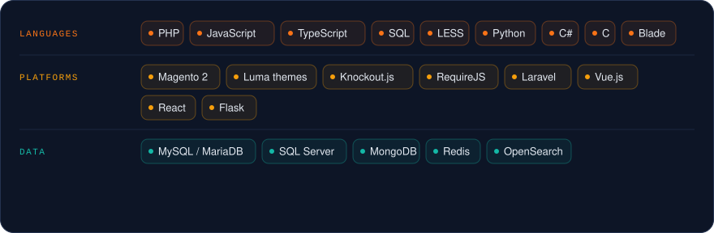

  

  

###  About me

I'm a backend engineer focused on **Magento 2 / PHP**. Day to day I support **50+ production
stores** in Brazil, B2C and B2B: the parts that move money and break at 3 a.m. - checkout,
payment gateways, ERP and shipping integrations, performance and security.

I'm comfortable across the stack: **Laravel** on the back end, **Vue** and **React** on the
front, **MySQL, SQL Server and MongoDB** for data, and **Python** for automation and data work.

###  What I work on

  

###  How I work

- **Evidence before conclusions.** Diagnose from the outside first (served HTML, logs, PageSpeed),
  confirm the exact symptom, and keep a record of every hypothesis that was ruled out.
- **Production is sacred.** Changes are tested in a production-mode homolog, shipped as one
  reviewed package and always come with a rollback.
- **Ship behavior changes safely.** New modules start in `log_only`, get validated by their own
  logs, and only then switch to `enforce`.
- **AI-assisted, human-owned.** I use Claude Code with task-specific skills and agents, plus a
  blind review by a second model on high-impact diagnoses. The final call is always mine.

###  Tech stack

  

###  Let's talk

Magento store that's slow, losing orders at checkout, or needs an integration done right?
Reach me on [LinkedIn](https://www.linkedin.com/in/otavio-hoff).

  

